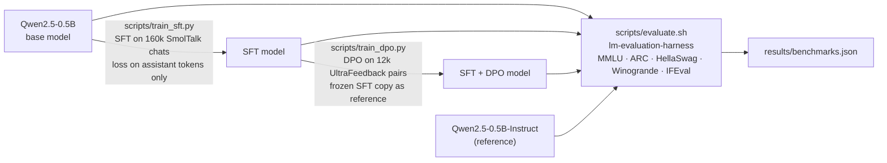

# Mini-ChatGPT: Building a Chat Assistant from a Base LLM — SFT → DPO → Benchmarks

[](https://github.com/kishorhange111/mini-chatgpt/actions/workflows/ci.yml)


**The ChatGPT recipe end to end on one GPU: a base model that can only continue text becomes an assistant through supervised fine-tuning, is aligned to human preferences with a hand-written DPO loss, and is measured on standard benchmarks against the model builder's own chat model.**

## Results
| Benchmark | Base | **SFT (ours)** | **SFT + DPO (ours)** | Qwen2.5-0.5B-**Instruct** (Qwen's official chat model) | 95% CI (±pts) |
|---|---|---|---|---|---|
| ARC-Easy | 58.4 | **64.5** | 64.3 | 59.2 | ±1.9 |
| ARC-Challenge | 32.3 | 33.5 | **33.8** | 33.2 | ±2.7 |
| IFEval — instruction-level strict | 22.7 | 36.5 | **36.7** | 36.3 | ±3.3 |
| IFEval — prompt-level strict | 12.6 | 23.5 | 24.0 | **26.4** | ±3.6 |
| HellaSwag | 52.2 | 51.6 | 52.0 | **52.4** | ±1.0 |
| Winogrande | 55.6 | 55.6 | 55.7 | 55.7 | ±2.7 |
| MMLU | **47.5** | 45.4 | 45.9 | 45.8 | ±0.8 |

**Headline:** a single ~3-hour SFT run on public data, starting from the same base model, **reaches Qwen's official instruct model on instruction-level IFEval (36.7 vs 36.3, a statistical tie)** and is ahead on ARC-Easy by 5 points of length-normalised accuracy. Qwen's model stays ahead on prompt-level IFEval (26.4 vs 24.0).

How to read the table honestly:
- The last column is the 95% interval for one score (binomial, ±1.96·√(p(1−p)/n) on each test set's size). Gaps smaller than it are noise; differences between two models on the same questions are a little tighter than this, but not by much.
- ARC, HellaSwag numbers are **acc_norm** (log-likelihood divided by answer length, lm-eval's convention for these tasks). On plain **acc** the ARC-Easy gap shrinks to 66.6 vs 65.4 (+1.2), which is within noise; [`results/benchmarks.json`](results/benchmarks.json) has both. The +5 is real for acc_norm but partly reflects that SFT changed how the model spreads probability over long answers.
- So the fair summary is: SFT got this model to roughly the level of Qwen's own instruct release on these benchmarks, with much less data, not clearly past it.

- **Instruction following nearly doubles** (prompt-level 12.6 → 24.0 %, instruction-level 22.7 → 36.7 %) — the assistant behaviour SFT is designed to teach.
- **MMLU drops ~2 pts after SFT** — the well-known *alignment tax*; Qwen's own instruct model shows a similar drop (47.5 → 45.8).
- **DPO gives small, consistent gains** over SFT on 6 of 7 metrics (+0.2 – 0.5 pts). Honest reading: within benchmark noise. DPO here was deliberately light (LR 1e-6, 375 steps) to avoid damaging the SFT model; its preference accuracy on held-out pairs rose clearly (below).


### DPO: learning human preferences
| Held-out UltraFeedback pairs (500) | Before DPO (= SFT model) | After DPO |
|---|---|---|
| Reward accuracy — prefers the human-chosen answer | 52.4 % (≈ chance) | **68.2 %** |
| Mean reward margin (chosen − rejected) | 0.006 | **0.757** |


Every number above is taken from the raw files in [`results/`](results/); a unit test ([`tests/test_results_consistency.py`](tests/test_results_consistency.py)) fails if the README and those files ever disagree.

## Pipeline


| Stage | What happens | Data | Compute |
|---|---|---|---|
| 0. Base | `Qwen/Qwen2.5-0.5B` (494 M params) — knows language, cannot follow instructions | — | — |
| 1. **SFT** | learn the assistant role and the ChatML chat format; loss **only on assistant tokens** | 160k conversations from SmolTalk (**127 M tokens**) | 4,982 steps · ~2.8 A100-hours |
| 2. **DPO** | prefer the answer humans rated better; no reward model, no RL loop | 12k UltraFeedback preference pairs | 375 steps · 22 A100-minutes |
| 3. **Evaluation** | EleutherAI **lm-evaluation-harness** (the Open LLM Leaderboard tool) | MMLU, ARC-E/C, HellaSwag, Winogrande, IFEval | ~1 A100-hour |

## Example answers (greedy decoding, SFT + DPO model)
> **Explain the difference between a list and a tuple in Python.**
> In Python, both lists and tuples are used to store collections of items, but they have some key differences: 1. **Mutability**: Tuples are immutable, meaning their contents cannot be changed after creation. Lists, on the other hand, can be modified after creation. …

> **My code throws 'KeyError: user_id'. What does that mean and how do I fix it?**
> The `KeyError` exception in Python typically occurs when you try to access a key that doesn't exist in the dictionary or other data structure. …

All SFT vs. DPO answers: [`results/sft_vs_dpo_samples.json`](results/sft_vs_dpo_samples.json).

## How it works
### SFT — [`scripts/train_sft.py`](scripts/train_sft.py), logic in [`src/mini_chatgpt/sft_data.py`](src/mini_chatgpt/sft_data.py)
- **ChatML template:** `<|im_start|>user\n…<|im_end|>\n<|im_start|>assistant\n…<|im_end|>` — the model learns where turns start and, crucially, where its answer **ends**.
- **Loss masking:** user/system tokens get label `-100`; only assistant tokens are learned, so the model does not learn to imitate users.
- **Length bucketing:** conversations of similar length are batched together (custom sampler) → far less padding waste.
- bf16 mixed precision, gradient checkpointing, cosine LR with warm-up, effective batch 32, max 2,048 tokens.
- **Time budget + checkpoints every 300 steps**, so the run is resumable and spend is capped.

### DPO — [`scripts/train_dpo.py`](scripts/train_dpo.py), loss in [`src/mini_chatgpt/dpo_core.py`](src/mini_chatgpt/dpo_core.py) (implemented by hand, no TRL)
```
r(y) = β · [ log π(y|x) − log π_ref(y|x) ]          implicit reward, β = 0.1
L    = − log σ( r(y_chosen) − r(y_rejected) )         π_ref = frozen copy of the SFT model
```
The same objective as RLHF (maximise reward, stay close to the reference model), optimised directly on preference pairs — no reward model, no PPO. Policy in fp32 with bf16 autocast, reference in bf16, gradient checkpointing, effective batch 32 pairs.

### Evaluation — [`scripts/evaluate.sh`](scripts/evaluate.sh)
lm-evaluation-harness on four models with identical settings; chat models are prompted through their chat template (`--apply_chat_template`). [`src/mini_chatgpt/eval_summary.py`](src/mini_chatgpt/eval_summary.py) merges the per-run result files into `benchmarks.json`.

## Engineering notes (things that went wrong, and the fixes)
- **Cloud runtimes disappear.** Training ran on preemptible cloud A100s that were reclaimed several times mid-training. Every run is **resumable** (`get_last_checkpoint`), checkpoints were saved every 300 steps and continuously backed up off the machine, and SFT was resumed from backup twice without losing more than a few hundred steps.
- **Generation in training mode is silently broken.** The first DPO sample outputs degenerated after one token ("In ONGONGONG…"). Cause: with gradient checkpointing on and the model in train mode, the KV cache is dropped while `generate()` assumes it exists, so each step saw a single token. Fix: `model.eval()`, disable checkpointing, `use_cache=True` before generating. The trained weights were fine — a good example of why evaluation code needs its own tests.
- **Library drift:** transformers v5 changed `apply_chat_template(..., return_tensors="pt")` to return a dict; TrainingArguments dropped `warmup_ratio`/`group_by_length` (reimplemented as a custom length-bucketing sampler).

## Quickstart
Training and evaluation need a CUDA GPU (an A100 40 GB was used). Paths default to a Colab-style `/content/...` layout and can be changed through environment variables.
```bash
git clone https://github.com/kishorhange111/mini-chatgpt.git && cd mini-chatgpt
pip install -r requirements.txt      # torch, transformers v5, datasets, accelerate, lm_eval[ifeval] + this package
python scripts/train_sft.py          # SFT      (env: N_SAMPLES, TIME_BUDGET_HOURS, ...)
python scripts/train_dpo.py          # DPO      (SFT_PATH=/content/out/final)
bash scripts/evaluate.sh             # benchmarks for base / SFT / DPO / Qwen-Instruct
python scripts/generate_samples.py   # side-by-side answers
```
The full SFT run used [`configs/full.env`](configs/full.env) (`make train` loads it). Main settings:

| Script | Variable | Default | Meaning |
|---|---|---|---|
| `scripts/train_sft.py` | `MODEL` | `Qwen/Qwen2.5-0.5B` | base model to fine-tune |
| | `N_SAMPLES` / `MAX_LEN` | `150000` / `2048` | conversations used / token cap |
| | `TIME_BUDGET_HOURS` | `3.0` | save and stop after this long |
| | `OUT` | `/content/out` | checkpoints + `final/` model |
| `scripts/train_dpo.py` | `SFT_PATH` | `/content/out/final` | model to align (also the reference) |
| | `BETA` / `LR` | `0.1` / `1e-6` | DPO strength / learning rate |
| | `DPO_OUT` | `/content/dpo` | output folder |

## Project layout
```
mini-chatgpt/
├── src/mini_chatgpt/          # pure, unit-tested logic used by the scripts (installable package)
│   ├── chat_format.py         #   ChatML template + pure-Python renderer
│   ├── sft_data.py            #   loss masking, length bucketing, padding
│   ├── dpo_core.py            #   pair encoding, sequence log-probs, DPO loss
│   └── eval_summary.py        #   lm-eval result files -> benchmarks.json
├── scripts/                   # GPU entry points, one per pipeline stage
│   ├── train_sft.py           #   stage 1: SFT (load, tokenize, Trainer, save)
│   ├── train_dpo.py           #   stage 2: DPO training loop, preference metrics, before/after samples
│   ├── evaluate.sh            #   stage 3: lm-evaluation-harness on base / SFT / DPO / reference
│   ├── generate_samples.py    #   side-by-side SFT vs DPO answers for the README
│   └── chat.py                #   quick sampled chat with the SFT model
├── configs/full.env           # settings of the full SFT run
├── tests/                     # pytest suite (CPU only, no downloads)
├── results/                   # raw metrics, logs, plots and sample answers
├── .github/workflows/ci.yml   # lint + tests on every push and pull request
├── Makefile                   # make install / lint / test / train / dpo / eval
├── pyproject.toml             # package metadata, ruff + pytest config
├── requirements.txt           # GPU runtime stack (installs this package too)
└── requirements-dev.txt       # lint/test tooling
```

## Testing
The tests cover the logic where silent bugs would quietly ruin a run: that the token-by-token SFT encoding reproduces the chat template exactly, that only assistant tokens (and their end marker) reach the loss, that length bucketing is a reproducible permutation that removes most padding, that DPO batches and log-probabilities are masked correctly, that the loss matches its formula (and is `log 2` when policy = reference), that a few DPO steps on a toy model learn the preference, and that the README numbers match `results/`. They use a character-level fake tokenizer and a tiny pure-torch model, so they run on CPU in seconds with no network.
```bash
pip install torch -r requirements-dev.txt -e .  # CPU torch is enough
make check                                       # = ruff check . && ruff format --check . && pytest
```
CI runs the same on every push and pull request ([`.github/workflows/ci.yml`](.github/workflows/ci.yml)).

## Limitations
- **One run per configuration.** No repeated seeds, so the small SFT → DPO differences (+0.2 – 0.5 pts) are within benchmark noise, as noted above.
- **Small scale.** A 0.5 B-parameter model and 160k SFT conversations; the recipe is the real one, but absolute quality is far from large chat models.
- **Light DPO.** 375 steps at LR 1e-6 on 12k pairs: enough to move preference accuracy, not enough to change benchmarks much.
- **GPU-only scripts.** `scripts/train_sft.py`, `scripts/train_dpo.py` and `scripts/generate_samples.py` assume CUDA (bf16, A100) and Colab-style default paths.
- **Weights not committed.** Model weights (~1 GB each) are not in the repository; the scripts regenerate them.

## Data and license
Data: SmolTalk (Hugging Face), UltraFeedback (binarized, HuggingFaceH4). Base model: Qwen2.5-0.5B (Apache-2.0). Code: Apache-2.0, see [LICENSE](LICENSE).
