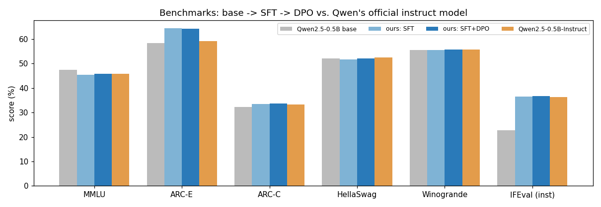
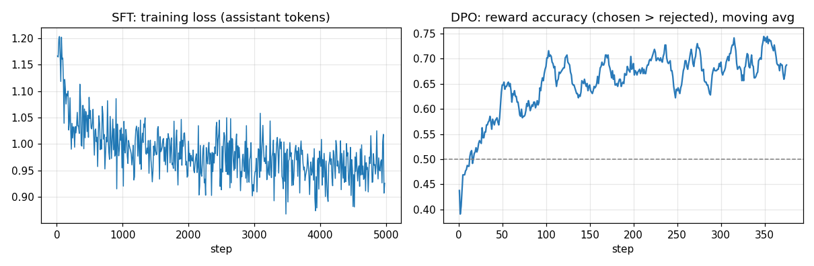

# Mini-ChatGPT: Building a Chat Assistant from a Base LLM — SFT → DPO → Benchmarks

The ChatGPT recipe, end to end, at a scale that fits one GPU: take a **pre-trained base model** that can only continue text, teach it to be an assistant with **supervised fine-tuning (SFT)**, align it to human preferences with **Direct Preference Optimization (DPO)**, and **measure every stage** on standard benchmarks against the model builder's own chat model.

| Stage | What happens | Data | Compute |
|---|---|---|---|
| 0. Base | `Qwen/Qwen2.5-0.5B` (494 M params) — knows language, cannot follow instructions | — | — |
| 1. **SFT** | learn the assistant role and the ChatML chat format; loss **only on assistant tokens** | 160k conversations from SmolTalk (**127 M tokens**) | 4,982 steps · ~2.8 A100-hours |
| 2. **DPO** | prefer the answer humans rated better; no reward model, no RL loop | 12k UltraFeedback preference pairs | 375 steps · 22 A100-minutes |
| 3. **Evaluation** | EleutherAI **lm-evaluation-harness** (the Open LLM Leaderboard tool) | MMLU, ARC-E/C, HellaSwag, Winogrande, IFEval | ~1 A100-hour |

## Results
| Benchmark | Base | **SFT (ours)** | **SFT + DPO (ours)** | Qwen2.5-0.5B-**Instruct** (Qwen's official chat model) |
|---|---|---|---|---|
| ARC-Easy | 58.4 | **64.5** | 64.3 | 59.2 |
| ARC-Challenge | 32.3 | 33.5 | **33.8** | 33.2 |
| IFEval — instruction-level strict | 22.7 | 36.5 | **36.7** | 36.3 |
| IFEval — prompt-level strict | 12.6 | 23.5 | 24.0 | **26.4** |
| HellaSwag | 52.2 | 51.6 | 52.0 | **52.4** |
| Winogrande | 55.6 | 55.6 | 55.7 | 55.7 |
| MMLU | **47.5** | 45.4 | 45.9 | 45.8 |



**Headline:** a single ~3-hour SFT run on public data **matches Qwen's official instruct model on instruction-level IFEval (36.7 vs 36.3) and beats it on ARC-Easy (+5 pts)**, starting from the same base model; Qwen's model stays ahead on prompt-level IFEval (26.4 vs 24.0).

- **Instruction following nearly doubles** (prompt-level 12.6 → 24.0 %, instruction-level 22.7 → 36.7 %) — the assistant behaviour SFT is designed to teach.
- **MMLU drops ~2 pts after SFT** — the well-known *alignment tax*; Qwen's own instruct model shows a similar drop (47.5 → 45.8).
- **DPO gives small, consistent gains** over SFT on 6 of 7 metrics (+0.2 – 0.5 pts). Honest reading: within benchmark noise. DPO here was deliberately light (LR 1e-6, 375 steps) to avoid damaging the SFT model; its preference accuracy on held-out pairs rose clearly (below).

### DPO: learning human preferences
| Held-out UltraFeedback pairs (500) | Before DPO (= SFT model) | After DPO |
|---|---|---|
| Reward accuracy — prefers the human-chosen answer | 52.4 % (≈ chance) | **68.2 %** |
| Mean reward margin (chosen − rejected) | 0.006 | **0.757** |



### Example answers (greedy decoding, SFT + DPO model)
> **Explain the difference between a list and a tuple in Python.**
> In Python, both lists and tuples are used to store collections of items, but they have some key differences: 1. **Mutability**: Tuples are immutable, meaning their contents cannot be changed after creation. Lists, on the other hand, can be modified after creation. …

> **My code throws 'KeyError: user_id'. What does that mean and how do I fix it?**
> The `KeyError` exception in Python typically occurs when you try to access a key that doesn't exist in the dictionary or other data structure. …

All SFT vs. DPO answers: [`results/sft_vs_dpo_samples.json`](results/sft_vs_dpo_samples.json).

## How it works
### SFT — [`train.py`](train.py)
- **ChatML template:** `<|im_start|>user\n…<|im_end|>\n<|im_start|>assistant\n…<|im_end|>` — the model learns where turns start and, crucially, where its answer **ends**.
- **Loss masking:** user/system tokens get label `-100`; only assistant tokens are learned, so the model does not learn to imitate users.
- **Length bucketing:** conversations of similar length are batched together (custom sampler) → far less padding waste.
- bf16 mixed precision, gradient checkpointing, cosine LR with warm-up, effective batch 32, max 2,048 tokens.
- **Time budget + checkpoints every 300 steps**, so the run is resumable and spend is capped.

### DPO — [`dpo.py`](dpo.py) (loss implemented by hand, no TRL)
```
r(y) = β · [ log π(y|x) − log π_ref(y|x) ]          implicit reward, β = 0.1
L    = − log σ( r(y_chosen) − r(y_rejected) )         π_ref = frozen copy of the SFT model
```
The same objective as RLHF (maximise reward, stay close to the reference model), optimised directly on preference pairs — no reward model, no PPO. Policy in fp32 with bf16 autocast, reference in bf16, gradient checkpointing, effective batch 32 pairs.

### Evaluation — [`eval.sh`](eval.sh)
lm-evaluation-harness on four models with identical settings; chat models are prompted through their chat template (`--apply_chat_template`).

## Engineering notes (things that went wrong, and the fixes)
- **Cloud runtimes disappear.** Training ran on Google Colab A100s driven from the terminal (Colab CLI). Runtimes were reclaimed several times mid-training; every run is **resumable** and a local loop ([`ops/backup_local.sh`](ops/backup_local.sh)) downloaded each new checkpoint — and the finished SFT/DPO models — in 200 MB pieces. [`ops/restore.sh`](ops/restore.sh) re-uploads a checkpoint to a fresh runtime (in 40 MB pieces — the upload API rejects large files) and training resumes where it stopped. SFT was resumed twice this way.
- **Generation in training mode is silently broken.** The first DPO sample outputs degenerated after one token ("In ONGONGONG…"). Cause: with gradient checkpointing on and the model in train mode, the KV cache is dropped while `generate()` assumes it exists, so each step saw a single token. Fix: `model.eval()`, disable checkpointing, `use_cache=True` before generating. The trained weights were fine — a good example of why evaluation code needs its own tests.
- **Library drift:** transformers v5 changed `apply_chat_template(..., return_tensors="pt")` to return a dict; TrainingArguments dropped `warmup_ratio`/`group_by_length` (reimplemented as a custom length-bucketing sampler).

## Run it
```bash
pip install torch transformers datasets accelerate "lm_eval[ifeval]"
python train.py                      # SFT      (env: N_SAMPLES, TIME_BUDGET_HOURS, ...)
python dpo.py                        # DPO      (SFT_PATH=/content/out/final)
bash eval.sh                         # benchmarks for base / SFT / DPO / Qwen-Instruct
python samples.py                    # side-by-side answers
```
Model weights (~1 GB each) are not committed. Data: SmolTalk (Hugging Face), UltraFeedback (binarized, HuggingFaceH4). Base model: Qwen2.5-0.5B (Apache-2.0).
